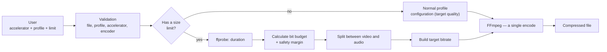
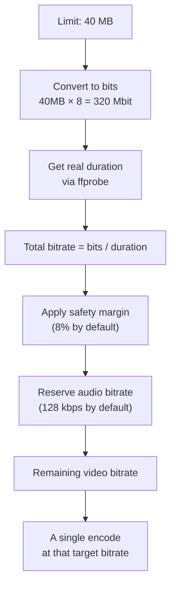

# 🎬 ClipSqueeze

🇧🇷 [Português](README.md) | 🇺🇸 English

**Smart video compression, right from your PowerShell terminal — CPU or GPU, profiles with real intent, and used the way you actually work: no need to memorize a single FFmpeg flag.**

<p align="center">
  
  
  
  
  
  
</p>

---

## 💡 Why this project exists

Compressing a quick video to send over Discord or WhatsApp shouldn't require knowing the difference between CRF and QP, what a `veryslow` preset even means, or why your 200MB file simply won't pass anyone's upload limit.

**ClipSqueeze** is built around a single PowerShell command, `Compress-Video`, that acts as an abstraction layer over FFmpeg: you say **where** to process (CPU or GPU), **how** to prioritize (speed, balance, efficiency, or quality), and, if you want, **how big** the final file can be. The script handles the rest.

```powershell
Compress-Video nvidia "meeting_recording" efficient 40mb
```

That's all you need to know to use it.

---

## 📑 Table of Contents

- [Features](#-features)
- [How it works](#-how-it-works)
- [Requirements](#️-requirements)
- [Installation](#-installation)
- [Updating and uninstalling](#updating-and-uninstalling)
- [Usage](#-usage)
- [Batch processing](#batch-processing)
- [Configuration](#configuration)
- [Compression profiles](#️-compression-profiles)
- [Size limit](#-size-limit)
- [Example run](#️-example-run)
- [Error handling](#-error-handling)
- [Technical challenges solved](#-technical-challenges-solved)
- [Known limitations](#-known-limitations)
- [Roadmap](#️-roadmap)
- [Contributing](#-contributing)
- [License](#-license)

---

## ✨ Features

- 🔍 **Automatic file detection** — paste the video name without an extension, the script finds the right file on its own.
- 📊 **Real progress panel** — a bar that actually fills up, elapsed time, estimated time remaining, and encoding speed, all live.
- ⚡ **CPU or GPU** — encode HEVC with `libx265`, or use AMD AMF or NVIDIA NVENC with HEVC, H.264, or AV1 depending on the available encoders.
- 🎚️ **Profiles with intent, not raw presets** — `fast`, `balanced`, `efficient`, and `quality` mean the same thing regardless of which accelerator you choose.
- 📦 **Optional size limit** — use `40mb` to calculate a target bitrate from the video's duration and apply a safety margin in a single encode.
- 🛠️ **FFmpeg self-diagnosis** — checks whether `ffmpeg`/`ffprobe` are installed and offers to install via `winget` on the spot if something's missing.
- 🧯 **Encoding diagnostics** — FFmpeg errors can be saved to a log for inspection.
- **Privacy** — removes descriptive output tags by default, including location, author, comments, and chapter titles.

---

## 🧠 How it works

The core idea is to separate **intent** from **implementation**. You never talk to FFmpeg directly — you talk to a profile, and the profile knows how to translate that into the right encoder settings.



With a limit such as `40mb`, the script applies the configured safety margin, reserves the audio bitrate, and uses the remaining budget as the target video bitrate for **one encode**. The resulting size depends on the encoder and container.

---

## 🛠️ Requirements

- Windows 10 (1809+) or Windows 11
- PowerShell 5.1 or later
- `ffmpeg` and `ffprobe` on your `PATH`. The installer can install `Gyan.FFmpeg` through WinGet with your confirmation. [FFmpeg Windows builds](https://www.gyan.dev/ffmpeg/builds/)
- For GPU acceleration, a graphics card and driver that support AMD AMF or NVIDIA NVENC, plus the corresponding FFmpeg encoder. AV1 encoding requires hardware support.

---

## 📦 Installation

To install from source, clone the repository and run the installer in the PowerShell host where you plan to use ClipSqueeze.

```powershell
git clone https://github.com/EduardoLopes085/ClipSqueeze.git
Set-Location ClipSqueeze
.\install.ps1
```

When an official package is available, you can also extract the ZIP and run `.\install.ps1` from the extracted folder. [GitHub Releases](https://github.com/EduardoLopes085/ClipSqueeze/releases)

The installer copies the main script to `%LOCALAPPDATA%\ClipSqueeze`, creates the initial configuration, and adds the loader to the current PowerShell profile. Open a new session in the same host to use `Compress-Video`. The installer asks for confirmation if it needs to change the user's execution policy or install FFmpeg.

For manual use, keep `ClipSqueeze.ps1` in a folder of your choice and load it into your session with the command below. Add the same line to your `$PROFILE` to load it at startup.

```powershell
. "C:\path\to\ClipSqueeze.ps1"
```

## Updating and uninstalling

To update a managed installation, run `.\update.ps1` from the extracted official signed ZIP. The updater checks the signature and hash before replacing the main script. To update a manual installation, replace your copy of `ClipSqueeze.ps1` with a trusted version. [Official updates](https://github.com/EduardoLopes085/ClipSqueeze/blob/main/docs/ci-cd.md#atualizações-oficiais)

To remove a managed installation, run the command below from the package or checkout folder.

```powershell
.\uninstall.ps1 -KeepFfmpeg
```

The uninstaller removes the managed installation and its PowerShell profile integration. Use `-KeepFfmpeg` to keep FFmpeg if ClipSqueeze installed it.

---

## 🚀 Usage

```powershell
Compress-Video <accelerator> <file> [profile] [limit] [-codec <codec>] [-container <container>] [-resolution <preset>] [-Metadata clean|preserve] [-Force]
```

> The alias `comprimir` (Portuguese for "compress") works exactly the same way and is kept for backward compatibility with the tool's original workflow.

| Parameter | Required | Accepted values | Default |
|---|---|---|---|
| `acelerador` | ✅ | `cpu`, `amd`, `nvidia` | — |
| `arquivo` | ✅ | Video name or path, with or without the extension | — |
| `perfil` | ❌ | `fast`, `balanced`, `efficient`, `quality` | `balanced` |
| `limite` | ❌ | Target limit in decimal MB, such as `40mb` | Profile's target quality |
| `-codec` | ❌ | `hevc`, `h264`, `av1` on GPU | `hevc` |
| `-container` | ❌ | `mp4`, `mkv`, `mov` | `mp4` |
| `-resolution` | ❌ | `hd`, `fhd`, `qhd`, `4k` | Accelerator's default scaling |
| `-Metadata` | ❌ | `clean` or `preserve` | `clean` |
| `-Force` | ❌ | Allows overwriting and recompression without prompting | Off |
| `-StopOnError` | ❌ | Stops the queue at the first failure | Off |
| `-PassThru` | ❌ | Returns a result object for each file | Off |

Each resolution preset sets the longer side in pixels for both landscape and portrait video. The defaults are 1280 for `hd`, 1920 for `fhd`, 2560 for `qhd`, and 3840 for `4k`. An explicit preset can upscale the image, and the output dimensions are adjusted to even numbers.

### Examples

```powershell
# Simple compression, balanced profile, no size restriction
Compress-Video cpu "meeting_recording"

# AMD with H.264 and HD resolution
Compress-Video amd "meeting_recording" quality -codec h264 -resolution hd

# NVIDIA with HEVC targeting a 40 MB limit
Compress-Video nvidia "meeting_recording" efficient 40mb -container mkv

# Quick CPU pass for a disposable preview
Compress-Video cpu "meeting_recording" fast

# Overwrite the existing output without a confirmation prompt
Compress-Video cpu "meeting_recording" -Force
```

Notice you don't need to type the file extension — if `meeting_recording.mp4` exists in the current folder, the script finds it on its own.

To use `-Force` in automation, supply the accelerator and input file, and ensure `ffmpeg` and `ffprobe` are on your `PATH`. The output still passes path and integrity checks before replacing an existing file.

Failures in `-Force` mode raise exceptions. Handle them with `try/catch` in scripts. An unhandled exception under `powershell.exe -File` or `pwsh -File` exits the process with a failure code.

## Batch processing

Supply a wildcard or a list of paths to process videos in a sequential queue.

```powershell
Compress-Video cpu ".\recordings\*.mp4" balanced 40mb -Force
Compress-Video nvidia @("meeting.mp4", "presentation.mkv") -resolution hd -PassThru
```

The list is resolved before encoding, sorted by path, and deduplicated. Wildcards select supported video extensions and exclude files ending in the configured output suffix. An existing literal path takes priority over wildcard interpretation. Searches stay within the specified directory.

An unmatched pattern or conflicting output paths stops the operation before encoding begins. The size limit applies to each video. File failures allow the queue to continue, while `-StopOnError` stops at the first error. Declining a confirmation marks the item as skipped.

`-PassThru` returns `Entrada` (input), `Saida` (output), `Status`, `Tempo` (elapsed time), and `Erro` (error) for each processed item. Status values are `Concluido`, `Ignorado`, and `Falhou`. A queue with failures reports an error at the end, or throws with `-Force` or `-StopOnError`. In automation, collect results as they arrive through the pipeline. The queue stays in memory during execution.

## Configuration

`config.json` lives alongside `ClipSqueeze.ps1`. For a managed installation, edit `%LOCALAPPDATA%\ClipSqueeze\config.json` and open a new session to load the changes. For manual use, start with the [example config.json](config.json). Omitted keys use the built-in defaults.

| Section | What it configures |
|---|---|
| `defaults` | Profile, GPU codec, container, and resolution preset. Specify the accelerator in each command. |
| `output` | Suffix, destination folder, and overwrite permission. By default, output goes next to the original with the `_comprimido` suffix, and the script asks before overwriting. |
| `resolutionPresets` and `profileOverrides` | Longer-side dimensions and profile settings per accelerator. |
| `audio` and `bitrateCalc` | Audio codec and bitrate, safety margin, and low-bitrate warning. |
| `metadata.mode` | Output tag policy. Set it to `preserve` to keep FFmpeg's default metadata copying behavior. |
| `notifications` and `logging` | Windows notifications and FFmpeg error logs. |

In `clean` mode, ClipSqueeze removes descriptive tags during the same encoding pass and validates the temporary file before publishing it. Cleaning keeps chapter start markers and valid language codes supported by the container. Technical tags generated by FFmpeg may appear in the output. Verification covers container, stream, and chapter tags exposed by `ffprobe`. Visible and audible information remains part of the content.

To keep FFmpeg's default metadata copying behavior for one encode, run the following command.

```powershell
Compress-Video cpu "video.mp4" -Metadata preserve
```

---

## 🎛️ Compression profiles

Each profile represents an **intent**, implemented differently depending on the chosen accelerator:

| Profile | Intent | CPU (`libx265`) | AMD (`hevc_amf`) | NVIDIA (`hevc_nvenc`) |
|---|---|---|---|---|
| `fast` | Quick encoding | `veryfast`, CRF 27 | `speed`, QVBR 32 | `p2`, CQ 32 |
| `balanced` *(default)* | Balance between time, quality, and size | `medium`, CRF 23 | `balanced`, QVBR 26 | `p4`, CQ 26 |
| `efficient` | More processing time for better compression efficiency | `veryslow`, CRF 23 | `quality`, QVBR 23 | `p6`, CQ 26 |
| `quality` | Prioritizes visual fidelity | `slow`, CRF 18 | `quality`, QVBR 18 | `p7`, CQ 20 |

The table shows HEVC defaults without a size limit. With a limit, the script uses the calculated target bitrate for rate control. H.264 and AV1 have their own GPU profile settings.

---

## 📏 Size limit

When you pass something like `40mb`, the script follows this reasoning:



The command interprets `mb` as decimal megabytes, with 1 MB equal to 1,000,000 bytes. The final file can exceed the limit even with the margin because its size depends on encoder behavior, container overhead, and metadata.

---

## 🖥️ Example run

```powershell
Compress-Video cpu ".\meeting_recording.mp4" balanced -resolution hd
```

With the default configuration, the command creates `meeting_recording_comprimido.mp4` next to the original. The terminal summary shows the original and final sizes and the percentage reduction.

---

## 🧯 Error handling

- **FFmpeg missing** → the script detects this and offers to install it via `winget` (the `Gyan.FFmpeg` package) right there, without leaving the terminal.
- **GPU encoder unavailable** → the script checks whether FFmpeg lists the encoder for the selected accelerator and codec. Driver or hardware failures can also surface during encoding.
- **Encoding failure** → when error logging is enabled, the script attempts to save FFmpeg's `stderr` as `<name>_erro_compressao.log`, in the source folder or the configured log folder.
- **Output file already exists** → by default, the script asks before overwriting. The temporary output must pass `ffprobe` validation before it is published to the destination.
- **Unfeasible size limit** → if the given limit is too small for the video's duration, the script refuses the compression instead of producing an unusable file.

---

## 🐛 Technical challenges solved

A few bugs that came up during development and are worth documenting, because they weren't obvious:

- **Locale-sensitive parsing**: on systems set to `pt-BR`, `[double]::TryParse("33.003000")` reads the dot as a thousands separator instead of a decimal point — turning 33 seconds into ~33 million. Fixed by forcing `CultureInfo.InvariantCulture` on every numeric conversion coming from `ffprobe`/`ffmpeg`.
- **False-positive error**: `Start-Process -PassThru` in PowerShell can return `.ExitCode = $null` even after a successful run, if the process handle isn't accessed right after `Start-Process`. Fixed by explicitly accessing `$proc.Handle`.
- **Unstable progress across FFmpeg builds**: not every build reports `out_time_ms` consistently. The fix was to calculate progress from the `frame=` counter (always present) divided by the expected total frame count (duration × fps), instead of relying on timestamps.
- **Incorrect duration metadata on trimmed clips**: videos trimmed by recording tools (e.g. Radeon ReLive) sometimes keep the duration metadata from the original recording, not the trimmed clip — silently inflating the denominator in the progress calculation.

---

## ⚠️ Known limitations

- CPU encoding uses HEVC (H.265) through `libx265`. Choosing H.264 or AV1 requires a compatible GPU encoder.
- The available GPU accelerators are AMD AMF and NVIDIA NVENC. Intel Quick Sync remains on the roadmap.
- With no resolution preset selected, the video keeps its aspect ratio and fits within 1920×1080 without upscaling.
- AMD and NVIDIA use the CPU to decode and resize the video. Encoding runs on the GPU through AMF or NVENC.

---

## 🗺️ Roadmap

- [x] GPU codec selection for H.264, HEVC, and AV1
- [x] NVIDIA NVENC support
- [x] Output container selection for MP4, MKV, and MOV
- [x] Native Windows notification on completion
- [x] Explanations for known FFmpeg errors
- [x] Output resolution presets via `-resolution`
- [ ] Intel Quick Sync support
- [x] Remove descriptive tags from the final video
- [ ] Install FFmpeg via Chocolatey/Scoop as well, in addition to winget
- [ ] Publish as a proper PowerShell module (`.psd1`) on the PowerShell Gallery
- [x] `-Force` flag for non-interactive compression
- [ ] Compress a specific segment of the video (trim by start/end time)
- [x] Batch processing with wildcards and a sequential queue

---

## 🤝 Contributing

Target contribution pull requests at `development` and use the PR template to explain the change and how to test it. For larger changes, open an issue first describing what you'd like to change.

CI validates the workflows, builds the package, and tests CPU compression and the installation lifecycle on PowerShell 5.1 and 7. Official releases come from `main` and require a signed package. [CI/CD guide in Portuguese](https://github.com/EduardoLopes085/ClipSqueeze/blob/main/docs/ci-cd.md)

---

## 📄 License

Distributed under the MIT License. See [LICENSE](LICENSE) for details.

---

<p align="center">Built with PowerShell, FFmpeg, and an uncomfortable number of hours debugging a locale bug.</p>
