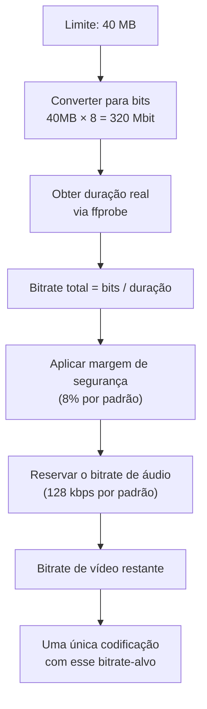

# 🎬 ClipSqueeze

🇧🇷 Português | 🇺🇸 [English](README.en.md)

**Compressão de vídeo inteligente, direto do seu terminal PowerShell — CPU ou GPU, perfis com intenção real, e do jeito que você realmente usa: sem precisar decorar flag nenhuma do FFmpeg.**

<p align="center">
  
  
  
  
  
  
</p>

---

## 💡 Por que este projeto existe

Comprimir um vídeo rápido pra mandar no Discord ou no WhatsApp não devia exigir que você saiba a diferença entre CRF e QP, o que é um preset `veryslow`, ou por que seu arquivo de 200MB simplesmente não passa no limite de upload de ninguém.

**ClipSqueeze** gira em torno de uma única função PowerShell, `comprimir`, que vira uma camada de abstração em cima do FFmpeg: você diz **onde** processar (CPU ou GPU), **como** quer priorizar (velocidade, equilíbrio, eficiência ou qualidade) e, se quiser, **quanto** o arquivo final pode pesar. O script cuida do resto.

```powershell
comprimir nvidia "gravacao_reuniao" efficient 40mb
```

Isso é tudo que você precisa saber pra usar.

---

## 📑 Sumário

- [Recursos](#-recursos)
- [Como funciona](#-como-funciona)
- [Requisitos](#️-requisitos)
- [Instalação](#-instalação)
- [Atualização e desinstalação](#atualização-e-desinstalação)
- [Uso](#-uso)
- [Configuração](#configuração)
- [Perfis de compressão](#️-perfis-de-compressão)
- [Limite de tamanho](#-limite-de-tamanho)
- [Exemplo em ação](#-exemplo-em-ação)
- [Tratamento de erros](#-tratamento-de-erros)
- [Desafios técnicos superados](#-desafios-técnicos-superados)
- [Limitações conhecidas](#-limitações-conhecidas)
- [Roadmap](#️-roadmap)
- [Contribuindo](#-contribuindo)
- [Licença](#-licença)

---

## ✨ Recursos

- 🔍 **Detecção automática de arquivo** — cole o nome do vídeo sem extensão, o script encontra o arquivo certo sozinho.
- 📊 **Painel de progresso real** — barra que preenche, tempo decorrido, tempo restante estimado e velocidade de codificação, tudo ao vivo.
- ⚡ **CPU ou GPU** — codifique em HEVC via `libx265` ou use AMD AMF e NVIDIA NVENC com HEVC, H.264 ou AV1, conforme os encoders disponíveis.
- 🎚️ **Perfis com intenção, não presets crus** — `fast`, `balanced`, `efficient` e `quality` significam a mesma coisa independente do acelerador escolhido.
- 📦 **Limite de tamanho opcional** — informe `40mb` para calcular o bitrate-alvo a partir da duração do vídeo e aplicar uma margem de segurança em uma única codificação.
- 🛠️ **Auto-diagnóstico do FFmpeg** — verifica se `ffmpeg`/`ffprobe` estão instalados e oferece instalar via `winget` na hora, se faltar algo.
- 🧯 **Diagnóstico de codificação** — erros do FFmpeg podem ser registrados em log para análise.

---

## 🧠 Como funciona

A ideia central é separar **intenção** de **implementação**. Você nunca fala com o FFmpeg diretamente — fala com um perfil, e o perfil sabe traduzir isso pro encoder certo.


Com um limite como `40mb`, o script aplica a margem de segurança configurada, reserva o bitrate de áudio e usa o restante como bitrate-alvo de vídeo em **uma única codificação**. O tamanho resultante depende do encoder e do contêiner.

---

## 🛠️ Requisitos

- Windows 10 (1809+) ou Windows 11
- PowerShell 5.1 ou superior
- `ffmpeg` e `ffprobe` no `PATH`. O instalador pode instalar o pacote `Gyan.FFmpeg` pelo WinGet com sua confirmação. [Distribuição do FFmpeg](https://www.gyan.dev/ffmpeg/builds/)
- Para GPU, uma placa e um driver com suporte a AMD AMF ou NVIDIA NVENC, além do encoder correspondente no FFmpeg. A codificação em AV1 depende de suporte específico no hardware.

---

## 📦 Instalação

Para instalar a partir do código-fonte, clone o repositório e execute o instalador no PowerShell em que pretende usar o ClipSqueeze.

```powershell
git clone https://github.com/EduardoLopes085/ClipSqueeze.git
Set-Location ClipSqueeze
.\install.ps1
```

Quando houver um pacote oficial, você também poderá extrair o ZIP e executar `.\install.ps1` dentro da pasta extraída. [GitHub Releases](https://github.com/EduardoLopes085/ClipSqueeze/releases)

O instalador copia o script principal para `%LOCALAPPDATA%\ClipSqueeze`, cria a configuração inicial e adiciona o carregamento ao perfil do PowerShell atual. Abra uma nova sessão no mesmo host para usar `comprimir`. O instalador solicita confirmação se precisar alterar a política de execução do usuário ou instalar o FFmpeg.

Para uso manual, mantenha `ClipSqueeze.ps1` em uma pasta de sua escolha e carregue-o na sessão com o comando abaixo. Para carregá-lo automaticamente, inclua a mesma linha no seu `$PROFILE`.

```powershell
. "C:\caminho\para\ClipSqueeze.ps1"
```

## Atualização e desinstalação

Para atualizar uma instalação gerenciada, execute `.\update.ps1` na pasta extraída do ZIP oficial assinado. O atualizador confere a assinatura e o hash da nova versão antes de substituir o script principal. Para atualizar uma instalação manual, substitua a cópia de `ClipSqueeze.ps1` por uma versão de confiança. [Atualizações oficiais](https://github.com/EduardoLopes085/ClipSqueeze/blob/main/docs/ci-cd.md#atualizações-oficiais)

Para remover uma instalação gerenciada, execute o comando abaixo na pasta do pacote ou do checkout.

```powershell
.\uninstall.ps1 -KeepFfmpeg
```

O desinstalador remove a instalação gerenciada e a integração no perfil. Use `-KeepFfmpeg` para manter o FFmpeg mesmo que ele tenha sido instalado pelo ClipSqueeze.

---

## 🚀 Uso

```powershell
comprimir <acelerador> <arquivo> [perfil] [limite] [-codec <codec>] [-container <container>] [-resolution <preset>]
```

> O comando "oficial" é `Compress-Video` (segue a convenção Verbo-Substantivo do PowerShell, a mesma de `Compress-Archive`) — o alias `comprimir` funciona exatamente igual e é o nome pensado pro uso do dia a dia.

| Parâmetro | Obrigatório | Valores aceitos | Padrão |
|---|---|---|---|
| `acelerador` | ✅ | `cpu`, `amd`, `nvidia` | — |
| `arquivo` | ✅ | Nome ou caminho do vídeo (com ou sem extensão) | — |
| `perfil` | ❌ | `fast`, `balanced`, `efficient`, `quality` | `balanced` |
| `limite` | ❌ | Limite-alvo em MB decimais, como `40mb` | Qualidade-alvo do perfil |
| `-codec` | ❌ | `hevc`, `h264`, `av1` em GPU | `hevc` |
| `-container` | ❌ | `mp4`, `mkv`, `mov` | `mp4` |
| `-resolution` | ❌ | `hd`, `fhd`, `qhd`, `4k` | Escala padrão do acelerador |

Cada preset de resolução define o lado maior em pixels, em vídeos horizontais e verticais. Os padrões são 1280 para `hd`, 1920 para `fhd`, 2560 para `qhd` e 3840 para `4k`. Um preset explícito pode ampliar a imagem e as dimensões são ajustadas para valores pares.

### Exemplos

```powershell
# Compressão simples, perfil balanceado, sem restrição de tamanho
comprimir cpu "gravacao_reuniao"

# AMD com H.264 e resolução HD
comprimir amd "gravacao_reuniao" quality -codec h264 -resolution hd

# NVIDIA com HEVC mirando um limite de 40 MB
comprimir nvidia "gravacao_reuniao" efficient 40mb -container mkv

# CPU rápido, pra um preview descartável
comprimir cpu "gravacao_reuniao" fast
```

Repare que você não precisa digitar a extensão do arquivo — se `gravacao_reuniao.mp4` existir na pasta atual, o script encontra sozinho.

## Configuração

O `config.json` fica ao lado de `ClipSqueeze.ps1`. Em uma instalação gerenciada, edite `%LOCALAPPDATA%\ClipSqueeze\config.json` e abra uma nova sessão para carregar as alterações. Na instalação manual, você pode usar o [config.json de exemplo](config.json). Chaves omitidas usam os padrões internos.

| Seção | O que configura |
|---|---|
| `defaults` | Perfil, codec da GPU, contêiner e preset de resolução. Informe o acelerador em cada comando. |
| `output` | Sufixo, pasta de destino e permissão de sobrescrita. O padrão grava na pasta de origem com sufixo `_comprimido` e pede confirmação antes de sobrescrever. |
| `resolutionPresets` e `profileOverrides` | Tamanho do lado maior e ajustes dos perfis por acelerador. |
| `audio` e `bitrateCalc` | Codec e bitrate de áudio, margem de segurança e aviso de bitrate baixo. |
| `notifications` e `logging` | Notificações no Windows e gravação dos logs do FFmpeg. |

---

## 🎛️ Perfis de compressão

Cada perfil representa uma **intenção**, implementada de forma diferente dependendo do acelerador escolhido:

| Perfil | Intenção | CPU (`libx265`) | AMD (`hevc_amf`) | NVIDIA (`hevc_nvenc`) |
|---|---|---|---|---|
| `fast` | Codificação rápida | `veryfast`, CRF 27 | `speed`, QVBR 32 | `p2`, CQ 32 |
| `balanced` *(padrão)* | Equilíbrio entre tempo, qualidade e tamanho | `medium`, CRF 23 | `balanced`, QVBR 26 | `p4`, CQ 26 |
| `efficient` | Mais tempo de processamento para melhorar a eficiência | `veryslow`, CRF 23 | `quality`, QVBR 23 | `p6`, CQ 26 |
| `quality` | Prioriza fidelidade visual | `slow`, CRF 18 | `quality`, QVBR 18 | `p7`, CQ 20 |

Os valores da tabela são os padrões para HEVC sem limite de tamanho. Com um limite, o script usa o bitrate calculado para controlar a taxa. H.264 e AV1 têm ajustes próprios nos perfis de GPU.

---

## 📏 Limite de tamanho

Quando você passa algo como `40mb`, o script segue este raciocínio:



O comando interpreta `mb` em MB decimais, com 1 MB igual a 1.000.000 de bytes. O tamanho final pode ultrapassar o limite mesmo com a margem, pois depende da variação do encoder e do espaço ocupado pelo contêiner e pelos metadados.

---

## 🖥️ Exemplo em ação

```powershell
comprimir cpu ".\gravacao_reuniao.mp4" balanced -resolution hd
```

Com a configuração padrão, o comando gera `gravacao_reuniao_comprimido.mp4` na mesma pasta do original. O resumo no terminal mostra os tamanhos original e final e a porcentagem de redução.

---

## 🧯 Tratamento de erros

- **FFmpeg ausente** → o script detecta e oferece instalar via `winget` (pacote `Gyan.FFmpeg`) na hora, sem precisar sair do terminal.
- **Encoder de GPU indisponível** → o script verifica se o FFmpeg lista o encoder do acelerador e codec escolhidos. Falhas de driver ou hardware também podem aparecer durante a codificação.
- **Falha na codificação** → com os logs ativados, o script tenta salvar o `stderr` do FFmpeg como `<nome>_erro_compressao.log`, na pasta do vídeo ou na pasta configurada.
- **Arquivo de saída já existe** → por padrão, o script pede confirmação antes de sobrescrever. A saída temporária precisa passar pela validação do `ffprobe` antes de ser publicada no destino.
- **Limite de tamanho inviável** → se o limite informado for pequeno demais para a duração do vídeo, o script recusa a compressão em vez de gerar um arquivo inutilizável.

---

## 🐛 Desafios técnicos superados

Alguns bugs que apareceram durante o desenvolvimento e valem registrar, porque não eram óbvios:

- **Parsing sensível a localidade (locale)**: em sistemas configurados em `pt-BR`, `[double]::TryParse("33.003000")` interpreta o ponto como separador de milhar, não decimal — transformando 33 segundos em ~33 milhões. A correção foi forçar `CultureInfo.InvariantCulture` em toda conversão numérica vinda do `ffprobe`/`ffmpeg`.
- **Falso positivo de erro**: `Start-Process -PassThru` no PowerShell pode retornar `.ExitCode = $null` mesmo após uma execução bem-sucedida, se o handle do processo não for acessado logo após o `Start-Process`. Resolvido acessando `$proc.Handle` explicitamente.
- **Progresso instável entre builds do FFmpeg**: nem todo build reporta `out_time_ms` de forma consistente. A solução foi calcular o progresso a partir do contador de `frame=` (sempre presente) dividido pelo total de frames esperado (duração × fps), em vez de depender de timestamps.
- **Metadados de duração incorretos em clipes cortados**: vídeos recortados por ferramentas de gravação (ex: Radeon ReLive) às vezes preservam metadados de duração da gravação original, não do clipe cortado — inflando o denominador do cálculo de progresso silenciosamente.

---

## ⚠️ Limitações conhecidas

- O caminho por CPU usa HEVC (H.265) via `libx265`. A escolha de H.264 ou AV1 exige um encoder de GPU compatível.
- Os aceleradores de GPU disponíveis são AMD AMF e NVIDIA NVENC. Intel Quick Sync ainda não é suportado.
- Sem `-resolution` ou um preset na configuração, o vídeo mantém a proporção e é ajustado para caber em 1920×1080 sem ampliar o original.
- Os aceleradores AMD e NVIDIA usam a CPU para decodificar e redimensionar o vídeo. A codificação usa AMF ou NVENC na GPU.

---

## 🗺️ Roadmap

- [x] Seleção de H.264, HEVC e AV1 em GPU
- [x] Suporte a NVIDIA (NVENC)
- [x] Manipulação do container de saída (mp4 / mkv / mov)
- [x] Notificação nativa do Windows ao concluir a compressão
- [x] Tradução de erros conhecidos do FFmpeg (ex: driver de GPU desatualizado) em dicas legíveis
- [x] Presets de resolução de saída via `-resolution`
- [ ] Suporte a Intel Quick Sync
- [ ] Reescrita/limpeza de metadados do vídeo final
- [ ] Publicar como módulo PowerShell (`.psd1`) na PowerShell Gallery
- [ ] Flag `-Force` para uso não-interativo, ideal pra automação
- [ ] Compressão de um trecho específico do vídeo (corte por tempo inicial/final)
- [ ] Suporte a lote — processar vários arquivos via wildcard em fila sequencial

---

## 🤝 Contribuindo

Abra pull requests de contribuição para `development` e use o modelo do PR para descrever a mudança e como testá-la. Para mudanças maiores, abra uma issue primeiro descrevendo o que você gostaria de alterar.

A CI valida os workflows, monta o pacote e testa a compressão em CPU e o ciclo de instalação no PowerShell 5.1 e 7. A publicação oficial parte da `main` e exige um pacote assinado. [Guia de CI/CD](https://github.com/EduardoLopes085/ClipSqueeze/blob/main/docs/ci-cd.md)

---

## 📄 Licença

Distribuído sob a licença MIT. Veja [LICENSE](LICENSE) para mais detalhes.

---

<p align="center">Feito com PowerShell, FFmpeg e um número desconfortável de horas debugando bug de locale.</p>
